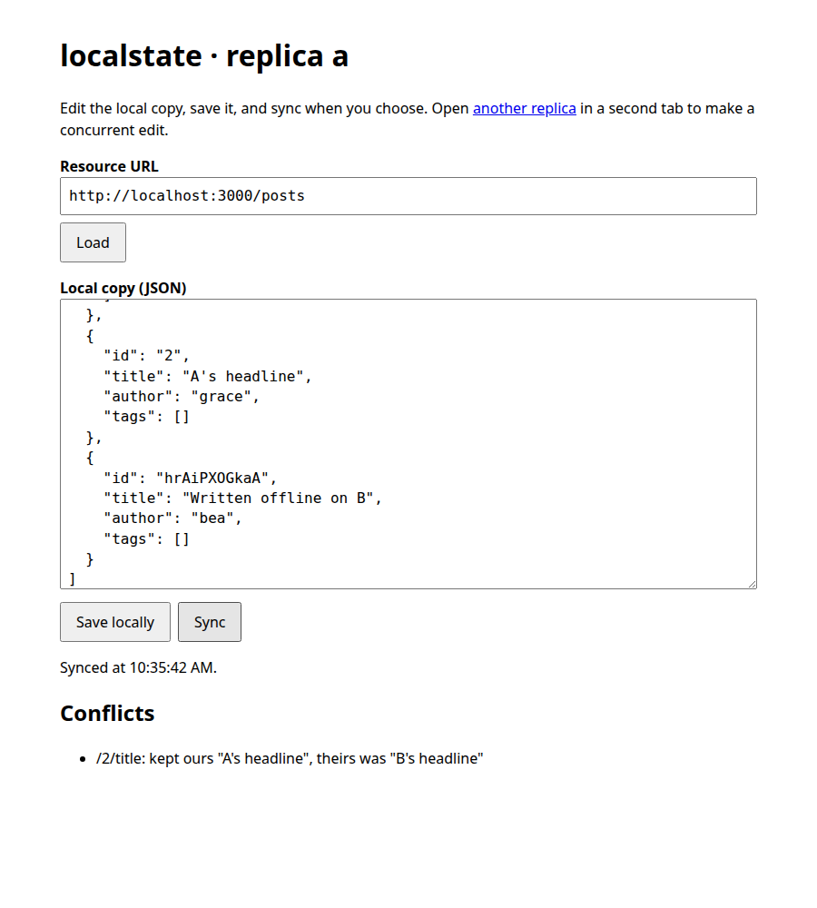
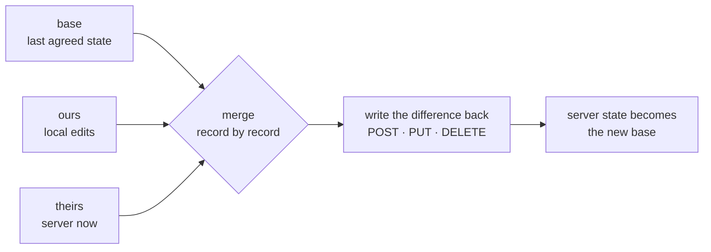

# localstate

**Offline-first for the REST API you already have.**

localstate keeps a local copy of any JSON resource in the browser, lets
people edit it with or without a connection, and merges their edits back
**field by field** with whatever changed on the server in the meantime.
It needs no special backend, no sync protocol and no metadata on the
server: if it speaks `GET`, `POST`, `PUT` and `DELETE`, it works.



## Why

Most apps that go offline handle it in one of two ways, and both cost you:

- **Overwrite on reconnect.** The client PUTs its copy back, and anything
  another user changed in the meantime is gone, even in fields this user
  never touched.
- **Adopt a sync engine.** CRDT libraries and local-first databases merge
  beautifully, but they bring their own server, protocol or storage
  format. That is a rewrite, and often not an option when the API belongs
  to someone else.

localstate takes a third path. It brings the merge to the client and
leaves the server exactly as it is.

## How it works

Every resource is kept as three versions of the same document:

| Version  | What it is                                               |
|----------|----------------------------------------------------------|
| `base`   | The server's state at the last successful sync           |
| `ours`   | The local copy, with every edit made since               |
| `theirs` | What the server holds right now, fetched at sync time    |

A sync is a **three-way merge**, the same mechanism `git merge` uses:



### Records, not documents

Each document is flattened into records keyed by
[JSON Pointer](https://www.rfc-editor.org/rfc/rfc6901):
`/posts/1/title`, `/profile/theme`. The merge then decides each record on
its own:

| `ours` vs `base` | `theirs` vs `base` | Result                          |
|------------------|--------------------|---------------------------------|
| unchanged        | unchanged          | keep it                         |
| changed          | unchanged          | **ours**: the local edit wins   |
| unchanged        | changed            | **theirs**: the server edit wins |
| changed the same | changed the same   | keep it, no conflict            |
| changed          | changed            | **conflict**, settled by you    |

A missing record is a value like any other, so a deletion is a change and
merges by the same rules. Two people editing different fields of the same
entity never collide; only edits to the same field are a conflict.

### Entities, not positions

An array whose elements all carry a unique `id` is a **list of entities**,
and its records are keyed by that id: `/posts/42/title`, not
`/posts/0/title`. Inserting a post at the top renames nothing, so
additions and removals from both sides merge as sets. The server decides
the order of what both sides kept, and new local entities follow. Any
other array is a single value.

### Writing back

The merge result is compared with `theirs`, and only the difference is
sent, in the shape REST expects:

- **A collection of entities** is written entity by entity: `POST` for
  added, `PUT` for changed, `DELETE` for removed.
- **Anything else** is replaced whole with one `PUT`. When the server
  sends an `ETag`, the `PUT` carries `If-Match`. A `412 Precondition
  Failed` means someone wrote first, so localstate fetches again,
  re-merges and retries, up to three attempts.

After writing, the server's state is fetched once more and becomes the new
`base`. That is also how ids assigned by the server replace the
placeholders a client used while offline.

## The theory, briefly

Distributed state has two famous answers. **CRDTs** make every operation
commute, so replicas converge with no coordinator. That power has a price:
metadata on every value and a sync layer that understands it. **Operational
transformation** needs a central server that transforms operations.

A REST API already *is* a central server. It serializes writes and owns
the truth, so the client does not need commutativity; it needs to know
**what it changed**. Keeping `base` gives exactly that. The diff of `ours`
against `base` is the user's intent, the diff of `theirs` against `base`
is everyone else's, and a three-way merge combines the two while naming
the only real conflicts: two different changes to one field.

The client stores three copies of each resource, and the server stores
nothing new.

## Try it

Requires Node 22.12 or newer.

```sh
npm install
npm start          # json-server on http://localhost:3000, seeded from db.json
```

1. Open <http://localhost:3000/index.html?replica=a> and
   <http://localhost:3000/index.html?replica=b> in two tabs. Each replica
   has its own IndexedDB database, so the two tabs behave like two
   devices.
2. **Load** in both.
3. In **a**, change the title of post `1`, then **Save locally**. Don't
   sync yet: you are "offline".
4. In **b**, change the author of post `1` and add
   `{ "id": "tmp", "title": "Written on b" }`, then **Save locally** and
   **Sync**.
5. In **a**, **Sync**. Post `1` now has a's title *and* b's author, and
   b's post is there with the id the server gave it.
6. Now edit the *same* field in both tabs and sync both. The second sync
   lists the conflict.

`npm start` serves a working copy, `data.json`, so the seed stays clean.
Delete `data.json` to start over.

## API

```js
import { openstore } from "./modules/storage.js";
import { get, edit, sync } from "./modules/state.js";

const db = await openstore("my-app");            // one database per replica
const url = new URL("https://api.example.com/posts");

await get(db, url, render);   // render(local) at once, then render(synced)
await edit(db, url, posts);   // save an edit locally; works offline
const { data, conflicts } = await sync(db, url, resolve);
```

- **`get(db, url, ondata)`** calls `ondata` with the local copy straight
  away, if there is one, then syncs and calls it again with the result.
- **`edit(db, url, data)`** replaces the local copy. The resource must
  have been fetched once, so there is a `base` to merge against.
- **`sync(db, url, resolve)`** merges and writes back. It returns the
  server's state and the conflicts it settled. Offline, it rejects with
  fetch's `TypeError` and leaves the local copy untouched. A refused
  request rejects with a `RemoteError` carrying the HTTP status.
- **`resolve(conflict)`** receives `{ pointer, base, ours, theirs }`. Each
  side is a record (`{ kind: "value", value }`, `{ kind: "object" }` or
  `{ kind: "list", order }`) or `undefined` for deleted, and `resolve`
  returns the side to keep. The default keeps ours.

## Limits

These hold now, and each is a design choice you should know about:

- **Same-field edits need a resolver.** The default keeps the local edit
  and reports the server's value it replaced.
- **Deleting an entity beats a concurrent edit inside it,** and that edit
  is not reported.
- **Collections have a small race window.** Entity writes carry no
  `If-Match`, because REST collections have no per-entity ETag in the
  listing. A write that lands between localstate's fetch and its write can
  be overwritten. Single resources with ETags are fully guarded.
- **Creates are not idempotent when the server assigns ids.** If a sync
  fails after a `POST` succeeded, the next sync can post the same entity
  again.
- **Arrays without ids are atomic.** `["a", "b"]` merges as one value.
- **One sync at a time per replica.** Edits go through `edit`, and a sync
  replaces the local copy with the merged result.
- **The resource must round-trip.** What `GET` returns is what `PUT`
  accepts. Views such as `?_embed=` are read-only for this purpose.

## Development

```sh
npm test
```

27 tests run with Node's built-in runner. They cover the flattening, every
merge rule, and sync between two replicas through a real json-server,
including offline, deletion, conflicts and a server that enforces `ETag`.
The run fails below 100% line coverage of `public/modules`.

| Module                      | Responsibility                               |
|-----------------------------|----------------------------------------------|
| `public/modules/json.js`    | flatten a document into records and back     |
| `public/modules/merge.js`   | three-way merge of records                   |
| `public/modules/state.js`   | `get`, `edit`, `sync`, and writing back      |
| `public/modules/storage.js` | one IndexedDB store of `{ url, base, ours }` |
| `public/modules/fetch.js`   | HTTP with `ETag` and typed errors            |

## License

MIT
